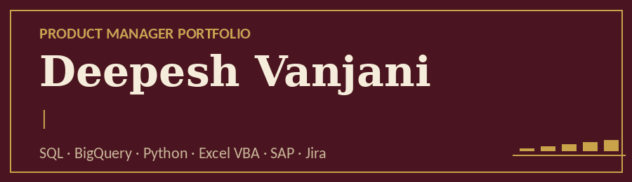
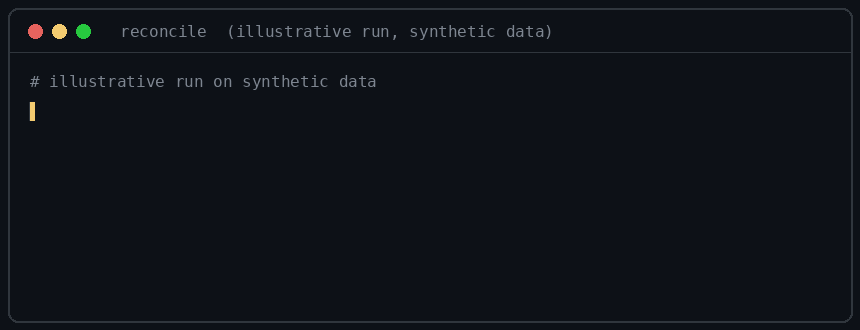

**Product Manager** focused on reconciliation, financial controls, and fraud analytics for fintech and payments.

- Owned a product roadmap and MVP delivery to 10+ paying customers and $125K in annual revenue
- Automated a five-system reconciliation from about 4 hours to about 4 minutes (99.99% accuracy on 70K+ line items)
- Led a forensic audit whose report informed policy enforcement

**Start here:** [Product Manager Portfolio](https://github.com/vanjanideepesh/deepesh-portfolio)
